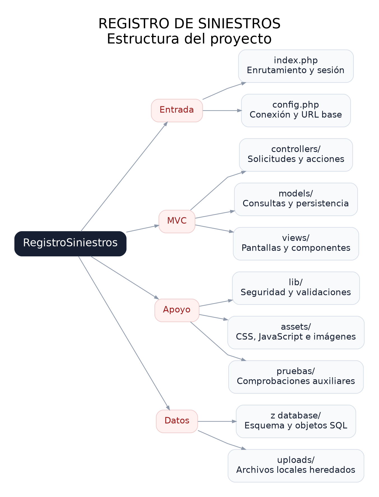
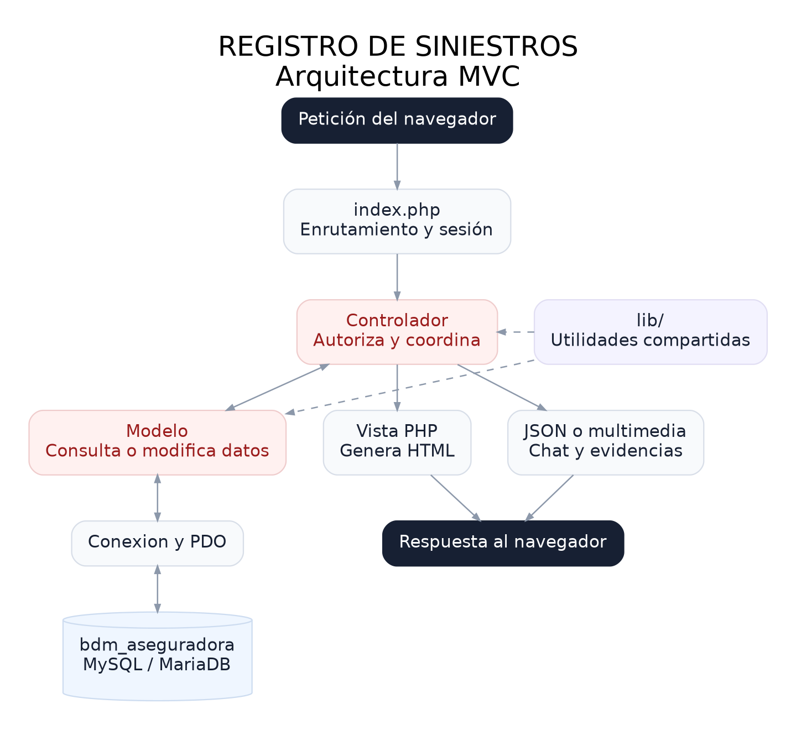

# Registro de Siniestros · Seguros FCFM

Aplicación web académica para registrar y dar seguimiento a siniestros de vehículos, consultar pólizas, administrar responsables, conservar evidencias multimedia y conversar dentro de cada expediente.

**Área:** Base de Datos Multimedia.  
**Autoría indicada en la aplicación:** Michelle y Raúl.  
**Versión documentada:** contenido de `RegistroSiniestrosFinal.rar`.

## Contenido

- [Descripción y funciones](#descripción-y-funciones)
- [Roles y permisos](#roles-y-permisos)
- [Tecnologías](#tecnologías)
- [Instalación en XAMPP](#instalación-en-xampp)
- [Uso del sistema](#uso-del-sistema)
- [Chat por siniestro](#chat-por-siniestro)
- [Evidencias multimedia](#evidencias-multimedia)
- [Arquitectura y estructura](#arquitectura-y-estructura)
- [Seguridad y alcance](#seguridad-y-alcance)
- [Pruebas](#pruebas)
- [Solución de problemas](#solución-de-problemas)
- [Documentación técnica](docs/REFERENCIA_TECNICA.md)
- [Inventario y diagramas editables](docs/ESTRUCTURA.md)

## Descripción y funciones

El sistema reúne la información del asegurado, su póliza y vehículo, el reporte del siniestro y las acciones necesarias para su seguimiento. Cada expediente relaciona al asegurado con el ajustador asignado y permite la intervención del supervisor.

Las funciones presentes en esta versión son:

- Registro, inicio y cierre de sesión; edición del perfil y fotografía.
- Consulta de las pólizas relacionadas con la cuenta.
- Registro de siniestros con fecha, hora, ubicación, descripción y evidencias opcionales.
- Listado de expedientes filtrado según el rol y la relación con el caso.
- Asignación, reasignación o retiro del ajustador por el supervisor.
- Evaluación del siniestro y consulta del historial de cambios de estatus.
- Visualización autenticada de fotos y videos.
- Chat privado e independiente para cada siniestro.
- Panel de supervisión con resumen de estatus, carga de ajustadores y clientes.
- Avisos de error y confirmación dentro de la página.

La **aseguradora** es la compañía registrada en el catálogo; el **asegurado** es el propietario de la póliza y el **ajustador** es el usuario responsable de atender el caso. No son nombres intercambiables.

## Roles y permisos

| Operación | Asegurado | Ajustador | Supervisor / admin |
| --- | --- | --- | --- |
| Consultar y editar el perfil propio | Sí | Sí | Sí |
| Consultar pólizas propias | Sí | Solo las vinculadas a su cuenta, si las tiene | Solo las vinculadas a su cuenta, si las tiene |
| Reportar un siniestro | Con una póliza propia | No | No |
| Consultar expedientes y evidencias | De sus pólizas | De los casos asignados | De todos los casos |
| Asignar o reasignar ajustador | No | No | Sí, si el caso no está cerrado |
| Guardar una evaluación | No | En su caso asignado | En cualquier caso accesible |
| Actualizar estatus | No | No | Sí |
| Leer y enviar mensajes | En sus casos | En los casos asignados | En todos los casos |
| Consultar el resumen de supervisión | No | No | Sí |

El registro público crea una cuenta con rol **asegurado**. El código reconoce `admin` como equivalente de `supervisor`, aunque la instalación SQL crea únicamente los slugs `asegurado`, `ajustador` y `supervisor`.

No hay una pantalla activa para administrar roles ni un formulario completo de alta de pólizas. Las cuentas de ajustador/supervisor y los datos iniciales de las pólizas deben prepararse en la base de datos por el responsable de la instalación. Los números de rol no deben suponerse: la referencia lógica es `rol.slug`.

## Tecnologías

| Componente | Uso en el proyecto |
| --- | --- |
| PHP | Controladores, modelos, sesiones y generación de vistas |
| PDO MySQL | Conexión, consultas preparadas y transacciones |
| MySQL / MariaDB | Persistencia relacional, vistas, procedimientos y BLOB |
| Apache / XAMPP | Ejecución local de la aplicación |
| HTML y CSS | Formularios, páginas y diseño adaptable |
| Bootstrap 4.6 | Hoja de estilos local, complementada por CSS propio |
| JavaScript nativo | Chat, vista previa de archivos, avisos y navegación móvil |
| Node.js | Opcional: ejecutar las pruebas del cliente JavaScript |

La aplicación no requiere instalar paquetes con Composer o npm para utilizarse. El chat no necesita un servidor Node.js ni servicios externos.

## Instalación en XAMPP

### Requisitos

- Apache y MySQL/MariaDB disponibles en XAMPP.
- PHP con las extensiones **PDO MySQL** y **Fileinfo**, además de sesiones habilitadas.
- Tablas InnoDB para las transacciones y los bloqueos utilizados por reportes, asignaciones y chat.
- Navegador con soporte de JavaScript para la actualización automática del chat.

### Instalación en una base nueva

1. Extrae el proyecto y coloca la carpeta `RegistroSiniestros` dentro de `C:\xampp\htdocs`.
2. Inicia Apache y MySQL desde el panel de XAMPP.
3. Abre phpMyAdmin y comprueba que esté conectado a la misma instancia y puerto que utiliza el proyecto.
4. Importa **`z database/instalacion_completa.sql`**. El archivo crea `bdm_aseguradora`, sus tablas, vistas, procedimientos y los catálogos básicos de roles y estatus.
5. Revisa los parámetros de `config.php` y ajusta solo los que correspondan a tu equipo.
6. Prepara las cuentas y las relaciones de prueba: aseguradora, vehículo, asegurado y póliza. La instalación SQL no incluye las cuentas ni los expedientes de tu XAMPP original.
7. Abre [http://localhost/RegistroSiniestros/](http://localhost/RegistroSiniestros/).

No abras `index.php` con doble clic ni mediante `file://`: PHP debe ejecutarse a través de Apache. Si Apache utiliza otro puerto, inclúyelo en la URL del navegador.

### Configuración incluida

| Parámetro | Valor del proyecto final | Significado |
| --- | --- | --- |
| `DB_NAME` | `bdm_aseguradora` | Base de datos |
| `DB_USER` | `root` | Usuario de conexión local |
| `DB_PASS` | Cadena vacía | Contraseña de conexión local configurada |
| `DB_HOSTM` | `host=127.0.0.1;port=3307` | Servidor y puerto empleados por PDO |
| `DB_HOST` | `localhost` | Constante existente; el DSN actual usa `DB_HOSTM` |
| `urlsite` | Calculada con el host y la carpeta de ejecución | Base de las rutas de la aplicación |

El puerto **3307 es el de la base de datos**, no el puerto que se agrega a la dirección web. Los valores `root` y contraseña vacía corresponden al entorno local incluido, no a una configuración para publicar en Internet.

### Conservar o trasladar una instalación existente

Si el proyecto ya funciona, **no vuelvas a importar la instalación completa solamente para añadir esta documentación**. Copia este `README.md` y la carpeta `docs` junto a `index.php`; no necesitas reemplazar código ni ejecutar SQL.

Para mover todo el sistema a otro equipo:

1. Respalda el proyecto y exporta `bdm_aseguradora` con estructura, datos y rutinas desde phpMyAdmin.
2. Conserva la carpeta `uploads`, por si todavía hay registros que dependan de archivos anteriores.
3. Importa el respaldo en la nueva instancia y adapta `config.php`.
4. Verifica las cuentas, pólizas, chats y reproducción de evidencias.

**Importante:** las fotos y videos almacenados como BLOB viajan en el respaldo de la base de datos. El RAR del código no sustituye ese respaldo. El script `instalacion_completa.sql` tampoco contiene los mensajes o videos guardados en una base ya utilizada.

## Uso del sistema

### 1. Acceso y perfil

Registra una cuenta e inicia sesión con **alias y contraseña**. El parámetro de acceso es el alias, no el correo electrónico. Desde **Mi perfil** se pueden actualizar los datos de acceso y la fotografía.

### 2. Reporte del asegurado

Abre **Reportar siniestro**, selecciona una póliza propia, captura los datos y adjunta las evidencias si corresponde. El reporte y sus archivos se guardan dentro de una transacción: si la operación falla, se revierte el conjunto.

Una cuenta recién registrada puede no tener pólizas. Debe relacionarse una póliza antes de poder reportar un siniestro. Un reporte nuevo no recibe automáticamente un ajustador ni un estatus inicial: puede aparecer como **No Asignado** y **Sin Estatus** hasta que se gestione.

### 3. Asignación del responsable

El supervisor entra en **Asignar ajustadores** o en la tarjeta de asignación del expediente. Puede elegir un ajustador activo, sustituirlo o retirar la asignación. No se permite reasignar un caso cuyo estatus sea **Cerrado**.

Al reasignar, el responsable anterior deja de tener acceso en las siguientes comprobaciones. El historial y los mensajes anteriores no se eliminan.

### 4. Evaluación y seguimiento

El ajustador asignado consulta el expediente y registra su diagnóstico. El supervisor también puede guardar una evaluación. Existe como máximo una evaluación por siniestro: al volver a guardar se actualiza la existente.

El supervisor modifica el estatus. Si este cambia, se agrega un registro a `historialestatus`. Los estatus del catálogo inicial son: **En Evaluación**, **Aprobado**, **Rechazado**, **Pago en Proceso** y **Cerrado**. Son valores de catálogo; no representan una secuencia obligatoria de transición implementada por el sistema.

## Chat por siniestro

Se abre desde **Siniestros → Abrir chat del siniestro** o dentro del detalle del expediente.

- Participan el asegurado propietario, el ajustador actualmente asignado y cualquier supervisor autorizado.
- Cada siniestro conserva una conversación distinta en la tabla `chat`.
- Las lecturas y los envíos comprueban el rol y el estado de la cuenta en SQL, además de su relación con el caso.
- Sin ajustador, el asegurado y el supervisor todavía pueden conversar.
- El chat continúa disponible en casos cerrados; cerrar un expediente no elimina mensajes.
- Los mensajes admiten hasta **2000 caracteres** y muestran autor, rol y fecha/hora del servidor.
- Se cargan **50 mensajes por página** y se pueden consultar los anteriores.
- Con JavaScript, se consultan mensajes nuevos cada **5 segundos** mientras la pestaña está visible. Es sondeo periódico, no WebSocket.
- Enter crea otra línea; Ctrl+Enter envía. También se puede usar el botón de envío.
- Sin JavaScript, el formulario funciona con recarga de página.

Una denegación de acceso cierra el chat visible y bloquea el envío. Esto no retira mensajes que una persona ya leyó o copió cuando todavía estaba autorizada.

Si la conexión falla, el borrador se conserva en la pestaña. Los mensajes no se reenvían automáticamente: si un envío no se confirmó, revisa si apareció antes de volver a enviarlo. El chat es de texto; no incluye adjuntos, edición o eliminación de mensajes.

## Evidencias multimedia

Las fotografías y los videos nuevos se guardan en **`multimedia.archivo` de tipo `LONGBLOB`**, relacionados mediante `siniestro_id`. La interfaz muestra el contenido sin etiquetas que describan su almacenamiento.

| Restricción | Valor de `lib/Archivos.php` |
| --- | --- |
| Cantidad por reporte | Hasta 10 evidencias |
| Tamaño por archivo | Hasta 25 MiB |
| Tamaño total por reporte | Hasta 50 MiB |
| Lectura de contenido | Bloques de 1 MiB |
| Imágenes aceptadas | JPG, PNG, WEBP y GIF |
| Videos aceptados | MP4, WEBM, MOV y OGV, según MIME detectado |

Los avisos de la interfaz utilizan la abreviatura MB para estos límites binarios. Fileinfo verifica el tipo real del archivo; el sistema no se basa únicamente en su extensión.

Las evidencias se entregan por `index.php?page=evidencia&id=ID` después de verificar permisos. La reproducción de video admite rangos HTTP para avanzar o retroceder. El almacenamiento en BLOB **no convierte el códec**: un formato que puede guardarse podría no reproducirse en todos los navegadores.

### Límites del servidor

Si los valores actuales ya permiten las cargas, no es necesario cambiarlos. Para trabajar con los límites del proyecto, revisa estos valores en el entorno local:

```ini
; php.ini de Apache
upload_max_filesize = 25M
post_max_size = 64M
memory_limit = 256M
max_file_uploads = 10
```

```ini
; my.ini, dentro de la sección [mysqld]
max_allowed_packet = 64M
```

Conserva el resto de la configuración y reinicia el servicio correspondiente si haces cambios. Un `LONGBLOB` no elimina los límites de PHP o del servidor de base de datos.

### Mantenimiento de videos anteriores

El conversor no aparece en el menú normal. Se conserva, restringido a supervisor/admin, en `index.php?page=migrarVideos`. Permite convertir archivos antiguos de `uploads/siniestros`, comprobar tamaño y SHA-256 y conservar el original como respaldo. No es una pantalla necesaria para el uso diario del sistema.

## Arquitectura y estructura

El proyecto utiliza una organización **Modelo–Vista–Controlador (MVC)**. `index.php` recibe el parámetro `page`, carga la configuración y dirige la petición al controlador correspondiente. Los modelos consultan la base mediante `Conexion`; los controladores preparan los datos y cargan las vistas o producen una respuesta JSON/binaria.



Las cajas **Entrada**, **MVC**, **Apoyo** y **Datos** son agrupaciones explicativas, no carpetas adicionales. El inventario detallado está en [docs/ESTRUCTURA.md](docs/ESTRUCTURA.md).



Las respuestas del chat y de las evidencias no necesitan una vista HTML completa. Los diagramas también se incluyen como SVG y como fuentes Mermaid editables en `docs/diagramas`.

## Seguridad y alcance

La implementación contiene controles de acceso a expedientes, consultas preparadas, tokens CSRF en operaciones de escritura, validación de evidencias, escape de texto y avisos de sesión. Las respuestas del chat y de las evidencias utilizan controles de caché para contenido privado.

Los errores visibles se muestran en la página; los parámetros normales de navegación como `page`, `id` o `filtro` permanecen en la URL. Las excepciones capturadas no imprimen consultas completas ni trazas al usuario.


## Pruebas

Desde una terminal, situado en la carpeta del proyecto:

```bat
cd C:\xampp\htdocs\RegistroSiniestros
C:\xampp\php\php.exe pruebas\reglas.php
C:\xampp\php\php.exe pruebas\avisos.php
C:\xampp\php\php.exe pruebas\chat.php
```

Estas pruebas PHP no necesitan conexión a la base. Para el cliente JavaScript, si tienes Node.js:

```sh
node pruebas/chat-cliente.cjs
```

Al preparar esta documentación se ejecutó la prueba JavaScript del archivo final y pasaron **10 escenarios simulados**. Las pruebas PHP y la integración con MySQL no se ejecutaron en este entorno; deben comprobarse en XAMPP. No se modificó el código funcional para esta entrega documental.

### Comprobación funcional sugerida

| Prueba | Resultado esperado |
| --- | --- |
| Acceso con alias y contraseña correctos | Panel correspondiente al rol |
| Credenciales incorrectas | Aviso dentro de la página |
| Reporte con póliza propia y foto/video | Expediente y evidencias disponibles |
| Intento de consultar un caso ajeno | Acceso denegado para el asegurado o ajustador ajeno |
| Asignar y reasignar un ajustador | Nuevo responsable autorizado; anterior sin acceso en nuevas peticiones |
| Reasignar un caso cerrado | Operación rechazada |
| Mensajes desde los tres roles | Conversación compartida únicamente dentro del siniestro |
| Dos siniestros diferentes | Historias de chat independientes |
| Cambio de estatus | Historial con el nuevo movimiento |
| Reproducción de video | Visualización y búsqueda dentro del contenido |

Para probar varias cuentas simultáneamente, utiliza perfiles de navegador distintos. Las pestañas de un mismo perfil comparten sesión.

## Solución de problemas

| Situación | Qué revisar |
| --- | --- |
| No conecta a la base | Servicio iniciado, `DB_HOSTM`, puerto 3307 y credenciales locales |
| Falta `sp_validar_usuario` | Importación de procedimientos en la misma base e instancia usadas por PHP |
| El inicio de sesión no acepta el correo | Usar el alias registrado |
| No aparecen pólizas para reportar | Relación `poliza.usuario_id` con la cuenta autenticada |
| No aparece un ajustador en el selector | Rol `ajustador` y `usuario.estatus = 1` |
| Falla la carga de multimedia | Formato, peso, límites de PHP y `max_allowed_packet` |
| El chat deja de permitir acceso | Sesión, estado activo, propiedad de la póliza o reasignación reciente |
| Un video se guarda pero no reproduce | Compatibilidad del códec con el navegador |
| Los estilos parecen anteriores | Recargar con Ctrl+F5 |

## Documentación técnica

- [Estructura e inventario de archivos](docs/ESTRUCTURA.md): jerarquía, MVC, responsabilidades y material de referencia.
- [Referencia técnica](docs/REFERENCIA_TECNICA.md): rutas, parámetros, tablas, procedimientos, vistas y reglas de negocio.
- `docs/diagramas/estructura.mmd` y `arquitectura_mvc.mmd`: diagramas editables en Mermaid.
- `docs/diagramas/*.svg`: versiones vectoriales; `*.png`: imágenes para documentos o presentaciones.

La documentación se elaboró revisando el código y los scripts SQL del archivo final. Los ejemplos describen esa versión; no suponen datos, usuarios o configuraciones adicionales existentes en otro equipo.
