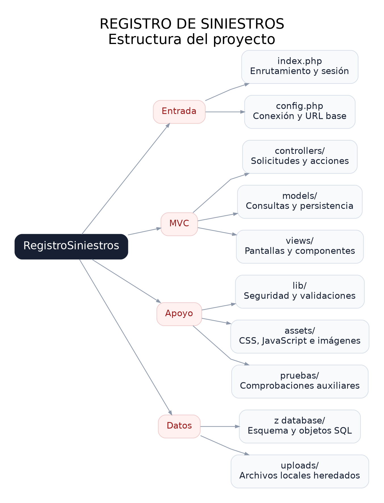
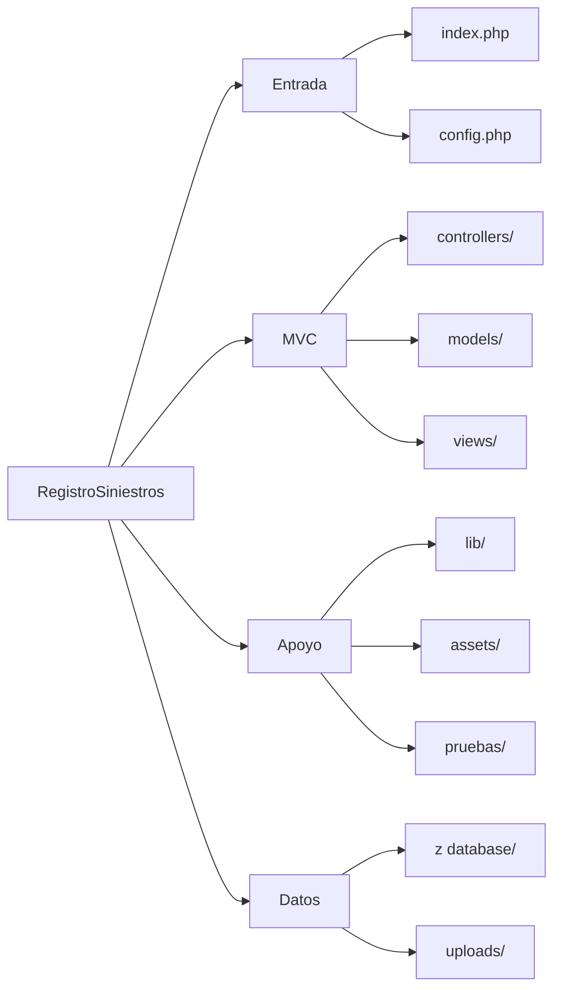
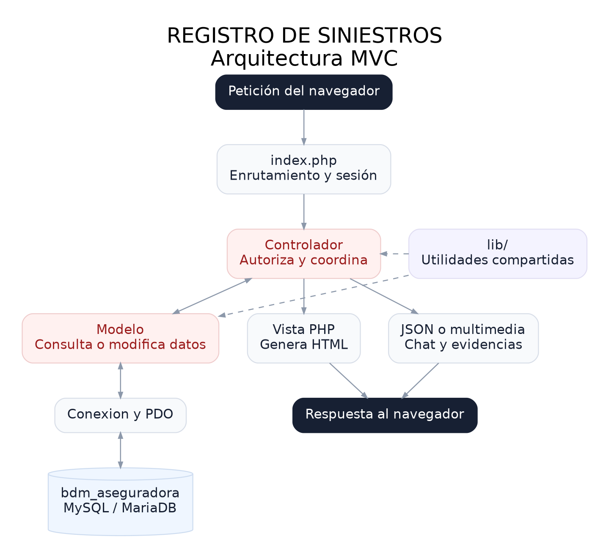
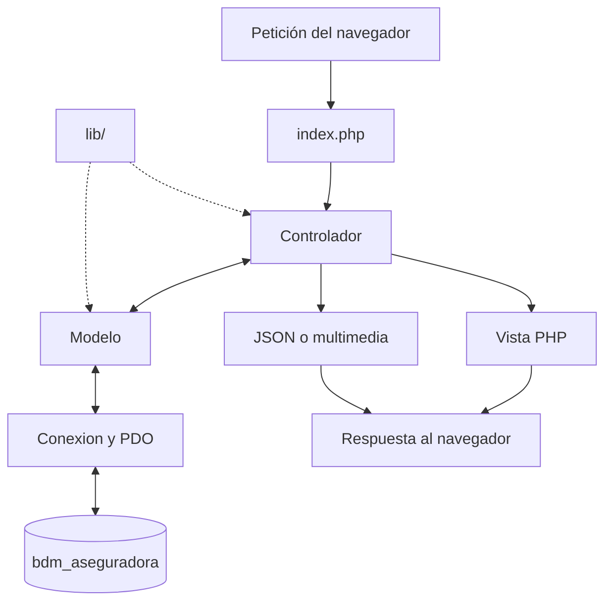

# Estructura y jerarquía del proyecto

[Volver al README](../README.md) · [Referencia técnica](REFERENCIA_TECNICA.md)

Las rutas de este documento son relativas a la carpeta `RegistroSiniestros`. El inventario describe el contenido del proyecto final recibido; añadir estos documentos no modifica sus controladores, modelos, vistas o base de datos.

## 1. Diagrama de estructura

El diagrama agrupa los elementos por responsabilidad. **Entrada**, **MVC**, **Apoyo** y **Datos** son categorías explicativas: no son directorios que deban crearse. Las carpetas reales son las indicadas con `/`.

Fuente editable independiente: `diagramas/estructura.mmd`. Imagen vectorial: `diagramas/estructura.svg`. Versión rasterizada: `diagramas/estructura.png`.

## 2. Flujo MVC

1. El navegador solicita una ruta de `index.php`, normalmente mediante `page`.
2. El archivo de entrada carga configuración, sesión y tratamiento de errores.
3. El controlador aplica las comprobaciones de la operación y solicita datos al modelo.
4. El modelo accede a la base mediante `Conexion` y PDO.
5. El controlador puede cargar una vista HTML, responder JSON para el chat o transmitir una evidencia.

Las líneas discontinuas representan dependencias de utilidades. Las flechas de doble sentido representan consultas/operaciones y devolución de resultados; no constituyen una segunda ruta HTTP.

## 3. Archivos de entrada

| Ruta | Función |
| --- | --- |
| `index.php` | Enrutador principal; carga configuración, sesión, avisos y controlador según `page` |
| `config.php` | Parámetros de conexión y cálculo de la URL base |

## 4. Controladores

Los subdirectorios de `controllers` organizan los módulos por dominio.

| Ruta | Responsabilidad y estado |
| --- | --- |
| `controllers/usuario/UsuarioC.php` | Acceso, registro, cierre de sesión, panel según rol y edición del perfil |
| `controllers/usuario/RolC.php` | Archivo vacío; no implementa administración de roles |
| `controllers/poliza/PolizaC.php` | Lista las pólizas de la cuenta; el bloque de alta comentado no está activo |
| `controllers/poliza/AutoC.php` | Recibe el formulario y registra un vehículo |
| `controllers/poliza/AseguradoraC.php` | Archivo vacío; no implementa administración de aseguradoras |
| `controllers/siniestro/SiniestroC.php` | Reporte, listados, detalle, evaluación, estatus, asignaciones y primera carga del chat |
| `controllers/siniestro/MultimediaC.php` | Entrega autenticada de evidencias y mantenimiento de videos antiguos |
| `controllers/siniestro/ChatC.php` | Lectura/envío del chat, parámetros, sesión, CSRF, errores JSON o redirección |

## 5. Modelos

| Ruta | Responsabilidad y estado |
| --- | --- |
| `models/Conexion.php` | Construye el DSN, crea PDO y proporciona la reversión segura de transacciones |
| `models/usuario/UsuarioM.php` | Registro e inicio de sesión por procedimientos; lectura y actualización de perfil; consultas de resumen |
| `models/usuario/RolM.php` | Archivo vacío |
| `models/poliza/PolizaM.php` | Consulta pólizas por usuario y contiene el método para llamar al alta SQL de póliza |
| `models/poliza/AutoM.php` | Inserta vehículos; conserva métodos vacíos que no constituyen un CRUD completo |
| `models/siniestro/SiniestroM.php` | Reportes con evidencias, asignación, permisos de listado, evaluación, historial y resumen del supervisor |
| `models/siniestro/MultimediaM.php` | Escritura LONGBLOB, metadatos, lectura por bloques, límite de paquetes y conversión heredada |
| `models/siniestro/ChatM.php` | Autorización actual en SQL, consultas paginadas y almacenamiento de mensajes |

El panel de supervisión utiliza `SiniestroM::getDashboardAdmin()`. También existe un método de resumen en `UsuarioM`, pero no es el que invoca ese panel en la ruta actual.

## 6. Vistas

### Componentes compartidos

| Ruta | Función |
| --- | --- |
| `views/layouts/header.php` | Documento HTML, estilos y apertura del contenido principal |
| `views/layouts/footer.php` | Pie de página, créditos y scripts globales |
| `views/layouts/navbar.php` | Navegación visible según el rol |
| `views/layouts/avisos.php` | Presentación escapada de avisos de sesión |
| `views/layouts/error.php` | Contenido de la pantalla de error |
| `views/layouts/busqueda.html` | Plantilla de referencia; no está conectada a una ruta de búsqueda activa |

### Usuarios

| Ruta | Función |
| --- | --- |
| `views/usuario/auth/LoginV.php` | Formulario de alias y contraseña |
| `views/usuario/auth/RegisterV.php` | Formulario de registro de asegurados |
| `views/usuario/EditProfileV.php` | Edición del perfil propio |
| `views/usuario/UserAuthV.php` | Inicio del asegurado |
| `views/usuario/AjustadorAdminAuthV.php` | Inicio de ajustador o supervisor; resumen administrativo cuando corresponde |
| `views/usuario/seleccionRol.php` | Archivo vacío, sin selector de roles funcional |

### Pólizas y vehículos

| Ruta | Función |
| --- | --- |
| `views/polizas/polizasV.php` | Listado de pólizas relacionadas con la cuenta |
| `views/polizas/autos/agregarAutoV.php` | Formulario de registro de vehículo |

### Siniestros y conversación

| Ruta | Función |
| --- | --- |
| `views/siniestros/reporteV.php` | Captura de datos del siniestro y selección de evidencias |
| `views/siniestros/listarSiniestrosV.php` | Tarjetas de expedientes; enlaces al detalle y al chat |
| `views/siniestros/detalle.php` | Datos, historial, evidencias, asignación, chat, estatus y evaluación |
| `views/siniestros/asignaciones.php` | Lista de asignaciones del supervisor y filtros |
| `views/siniestros/formAsignacion.php` | Selector y formulario reutilizable de responsable |
| `views/siniestros/avisoAsignacion.php` | Plantilla auxiliar conservada de aviso de asignación |
| `views/siniestros/migrarVideos.php` | Mantenimiento de videos, oculto de la navegación habitual |
| `views/siniestros/chat/panel.php` | Participantes, historial inicial, formulario y carga del JS del chat |
| `views/siniestros/chat/mensaje.php` | Mensaje individual con autor, rol y fecha; contenido escapado |
| `views/siniestros/tiposSiniestroV(Obsoleto)).php` | Vista antigua, fuera del enrutamiento principal |

## 7. Utilidades compartidas

| Ruta | Función |
| --- | --- |
| `lib/Seguridad.php` | Acceso a expedientes, rol supervisor/admin, tokens CSRF y normalización/escape |
| `lib/Avisos.php` | Mensajes de sesión, redirecciones, errores controlados y respuestas de excepción |
| `lib/Archivos.php` | Límites y MIME, cargas válidas, rutas antiguas restringidas y rangos HTTP |
| `lib/ChatReglas.php` | Validación de mensajes, permisos del actor y etiquetas de roles del chat |

## 8. Recursos del cliente

| Ruta | Función |
| --- | --- |
| `assets/css/bootstrap-4.6.min.css` | Estilos de Bootstrap incluidos localmente |
| `assets/css/style.css` | Diseño general, componentes, formularios y adaptación de pantalla |
| `assets/css/chat.css` | Panel de conversación, mensajes, participantes y estados |
| `assets/js/script.js` | Cierre de avisos y navegación móvil |
| `assets/js/preview.js` | Vista previa de las evidencias seleccionadas |
| `assets/js/chat.js` | Sondeo, envío, páginas anteriores, errores y bloqueo ante pérdida de acceso |
| `assets/js/dev-reload.js` | Recarga automática para desarrollo; `DEV_RELOAD` está desactivado |
| `assets/img/Logfamily.jpg` | Recurso gráfico incluido en el proyecto |

## 9. Pruebas incluidas

| Ruta | Cobertura principal |
| --- | --- |
| `pruebas/reglas.php` | Permisos de expedientes, rangos de bytes, rutas de evidencias, token y escape |
| `pruebas/avisos.php` | Avisos de sesión y presentación segura de errores |
| `pruebas/chat.php` | Reglas de acceso, validación Unicode y salida HTML del chat |
| `pruebas/chat-cliente.cjs` | Cliente JavaScript con DOM y respuestas simulados |

Los scripts PHP se ejecutan por CLI. El archivo CJS usa Node.js y no convierte a Node en una dependencia del servidor web.

## 10. SQL y archivos de datos

| Ruta | Uso y precauciones |
| --- | --- |
| `z database/instalacion_completa.sql` | Referencia principal para una base nueva: tablas, catálogos, vistas y procedimientos |
| `z database/tablas.sql` | Script de estructura separado; no debe importarse junto con todo lo demás sin revisar dependencias |
| `z database/vistas.sql` | Definiciones SQL de vistas por separado |
| `z database/procc.sql` | Definiciones de procedimientos por separado |
| `z database/triggers.sql` | Retira los disparadores antiguos de asignación e historial; no crea nuevos triggers activos |
| `z database/actualizacion_supervisor_blob.sql` | Actualización histórica: retira asignación aleatoria y consulta metadatos; no convierte por sí sola archivos de PHP |
| `z database/DD y diagrama SQL.sql` | Consultas de metadatos y definición de la vista `DICCIONARIO`; revisar el orden antes de ejecutar |
| `z database/functions.sql` | Archivo vacío; no define funciones SQL |
| `z database/carga de informacion(si es necesario).txt` | Archivo vacío; no proporciona datos de demostración |
| `z database/base de datos(Obsoleto).sql` | Material antiguo; no usar como instalador |
| `base de datos v2 agregar historial estatus.png` | Imagen de referencia incluida; el esquema vigente se comprueba en el SQL principal |
| `uploads/siniestros/SIN-3/video_6aac7967656f55.61944886.mp4` | Video local heredado incluido; no es un respaldo de todos los BLOB de la base |

El archivo del diccionario contiene una consulta a `DICCIONARIO` antes de su creación. La vista no forma parte de `instalacion_completa.sql`; por eso ese archivo no debe tratarse como un paso obligatorio ni ejecutarse a ciegas sobre una base nueva.

Las rutas antiguas de `uploads` se mantienen para compatibilidad y respaldo. Las evidencias nuevas se almacenan en la base; no se genera un archivo por cada nuevo BLOB en esa carpeta.

## 11. Cómo añadir esta documentación

Coloca `README.md` al lado de `index.php` y copia la carpeta `docs` al mismo nivel. Sus rutas relativas permiten consultar las imágenes y los documentos sin modificar la aplicación.

Los `.mmd` son fuentes Mermaid; los `.dot` describen las versiones renderizadas con Graphviz. Ambos representan los mismos nodos y relaciones. Los SVG permiten ampliar sin perder nitidez y los PNG pueden insertarse en presentaciones.

No es necesario subir estos documentos a una tabla de la base ni añadir nuevas rutas de PHP.
